[github.com/sanvidvaidya](https://github.com/sanvidvaidya)

> Product marketer pivoting to product management. 
> Building working software to test real product hypotheses.

I combine a product marketing background in go-to-market strategy, customer discovery, 
and positioning with hands-on technical prototyping. I build working applications in Python, 
TypeScript, and SQL to validate requirements, test customer retention models, and connect 
business goals with engineering execution.

<samp>product strategy &nbsp; go-to-market &nbsp; customer research &nbsp; python &nbsp; sql &nbsp; typescript &nbsp; react &nbsp; streamlit &nbsp; fastapi &nbsp; git</samp>

**[TRACE](https://github.com/sanvidvaidya/TRACE)** &nbsp;·&nbsp; <samp>python, streamlit, openapi</samp> 
Requirements engineering and systems mapping tool that turns ambiguous executive goals 
into testable architecture graphs and stops costly engineering rework.

**[healthgraph](https://github.com/sanvidvaidya/healthgraph)** &nbsp;·&nbsp; <samp>python, react, fhir r4</samp> 
FHIR-based clinical safety graph that connects fragmented medical records to catch 
drug-drug contraindications and genetic risks before doctors prescribe.

**[enterprise-decision-intelligence-simulator](https://github.com/sanvidvaidya/enterprise-decision-intelligence-simulator)** &nbsp;·&nbsp; <samp>python, streamlit, sqlite</samp> 
SaaS renewal decision simulator combining CRM data, usage telemetry, and support tickets 
to calculate customer churn risk and model intervention strategies.

**[lifemap](https://github.com/sanvidvaidya/lifemap)** &nbsp;·&nbsp; <samp>typescript, react</samp> 
Personal analytics web app that turns daily activity tracking into a visual gamified 
dashboard without sending data to third parties.

**[ai-product-research-system](https://github.com/sanvidvaidya/ai-product-research-system)** &nbsp;·&nbsp; <samp>python, react, vite</samp> 
Interactive product discovery and market research studio that generates PRDs, compares 
competitors, and prioritizes features with RICE scoring.

Every graphic here is generated, not embedded from anyone else's server. 
`ascii.svg` is a photo pushed through a character ramp by 
[`scripts/make_portrait.py`](scripts/make_portrait.py); the stat graphics and 
these section headings are drawn by [a scheduled action](.github/workflows/stats.yml) 
straight from the GitHub GraphQL API, once a day, committing only what changed.

They animate with SMIL inside the SVG, because GitHub strips scripts from 
READMEs - and since nothing loads from a third party, nothing here can 
rate-limit or go dark. The headings are SVGs for the same reason: GitHub also 
strips CSS, so an image is the only way to put this page's own typeface on them.

The typeface is [JetBrains Mono](scripts/fonts), subset to just the characters 
each graphic draws and inlined as base64. That isn't only for looks: the 
portrait's grid assumes an advance width of exactly 0.600 em, and a viewer whose 
default monospace is narrower would otherwise see it squeezed.

Language totals cover public repositories only. `year.svg` uses the portrait's 
character ramp: `:` `+` `#` `@`, quiet to loud.
